# EXP1  Building Up Development Environment

update: 2026-10-29

## 0 Why Use PyTorch

- Close to Python conventions
- Strong GPU support(NVidia CUDA, AMD ROCm, MTT musa, ...)
- Autograd-automatic differentiation
- Many algorithms and components are already implemented
- Similar to NumPy

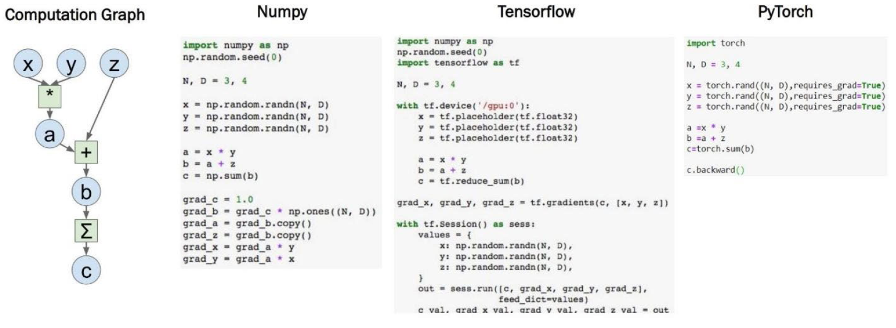


## 1 Deploy PyTorch and training networks on your laptop/desktop

### 1.1 Virtual Machine tools on Windows

VMware workstation player 17.0+ is recommended for our development, as it has been verified to work fine. Some open source/free solutions such as Virtual Box or Hyper-V from Microsoft should work fine but not verified.

VMware Workstation 17/16 Player is free for personal use. You can download **VMware Workstation  Player 17.5** from following links:

[VMware Workstation Player 17.5 installer](https://github.com/warner-ng/tongji-deep-learning/releases/download/course-assets-2026/VMware-player-full-17.5.0-22583795.zip)

NOTE: no license is needed, just skip license code input during installation.

### 1.2 Linux Distribution Release to use

Ubuntu Linux Desktop is highly recommended for our course experiment. The best release will be Ubuntu Desktop 22.04.x LTS, which has been verified. Here is the mirror site from Tsinghua University for download:

[https://mirrors.tuna.tsinghua.edu.cn/ubuntu-releases/22.04.5/ubuntu-22.04.5-desktop-amd64.iso](https://mirrors.tuna.tsinghua.edu.cn/ubuntu-releases/22.04.5/ubuntu-22.04.5-desktop-amd64.iso)

### 1.3 Installing Ubuntu Linux

#### 1.3.1 Hardware requirements

NVidia GPU is not mandatory for most of the experiments. You can only use CPU for most cases. But for fast running your program, assign as more as possible CPU cores and RAMs to the virtual machine.

Following parameters are recommended:

- CPU: N-2 cores, N=threads of your native CPU. e.g. If your CPU is 8 core/16 threads, N=16, assign 14 cores to virtual machine.
- RAM: M-8GB, M=total memory of your DDR SDRAM. e.g. If you got 32GB of RAM, assign 24GB to your virtual machine.
- HDD: 30GB


#### 1.3.2 Create a new virtual machine

Open VMware Workstation 17 Player, click "Create a New Virtual Machine",  assign Installer disc image file (iso), which means the iso file you have download before.

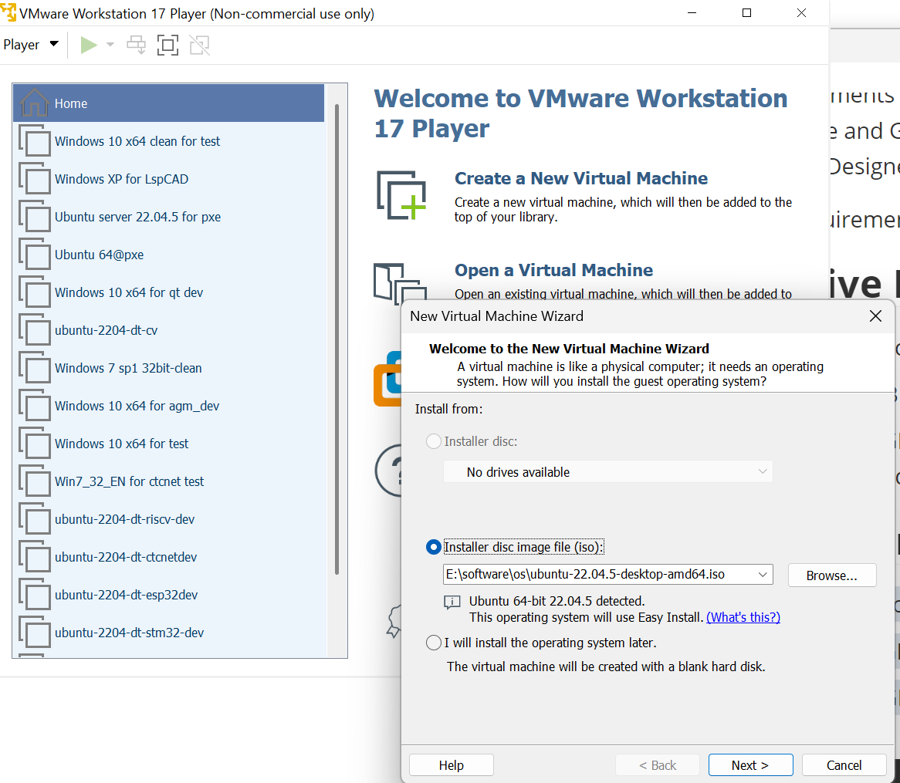

Fill the info for the new VM.

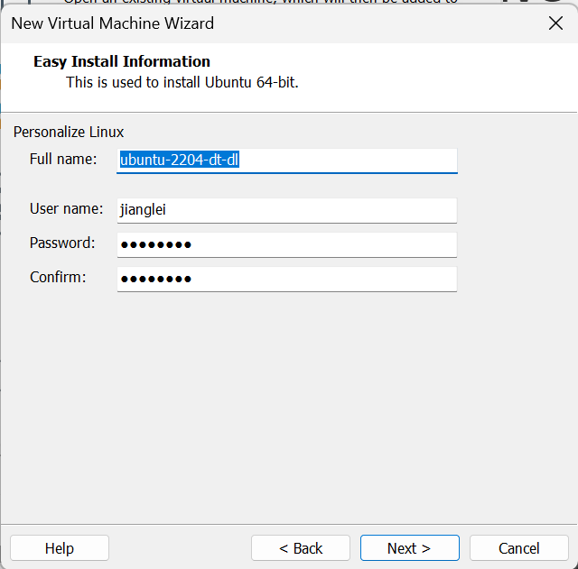

Then point to some location to store your virtual machine. Note that the location should have sufficient free space greater than 20GB.

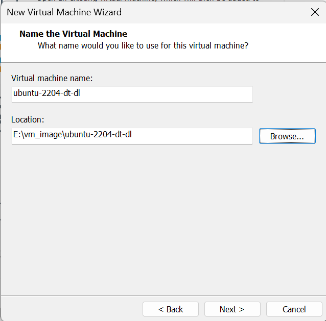

Set the disk space for VM.

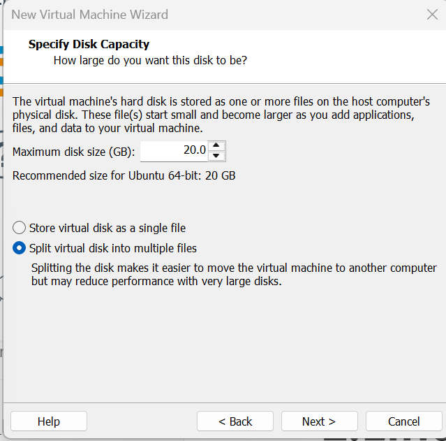

Remove the check on "Power on this virtual machine after creation". Then press <Finish>

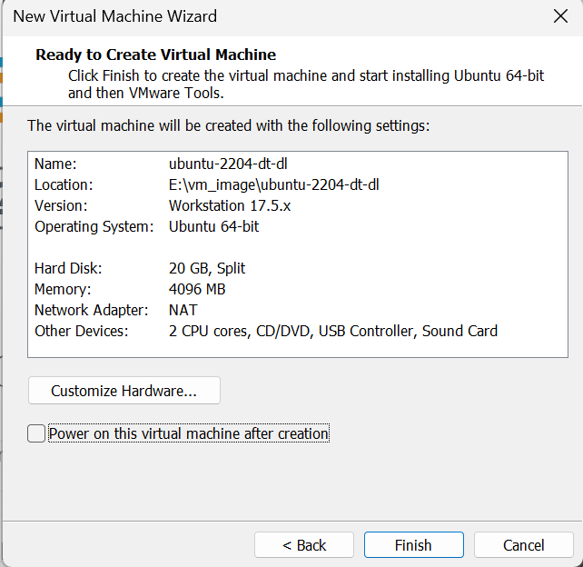

Edit the settings of the VM.

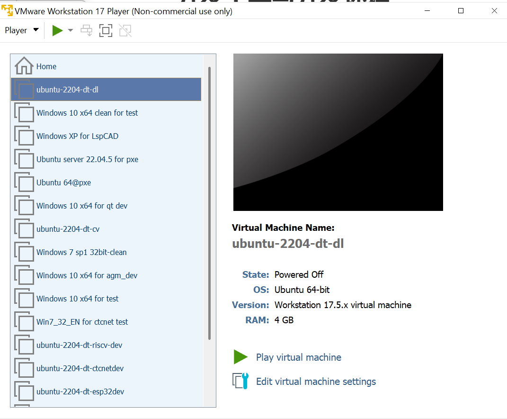

Modify the number of processor cores:

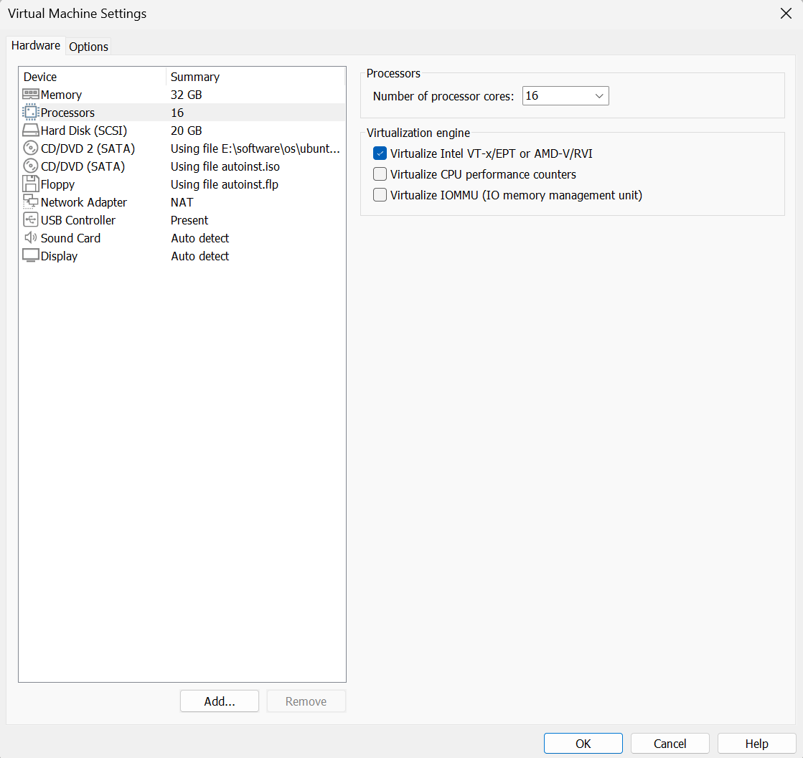

Assign Memory for VM:

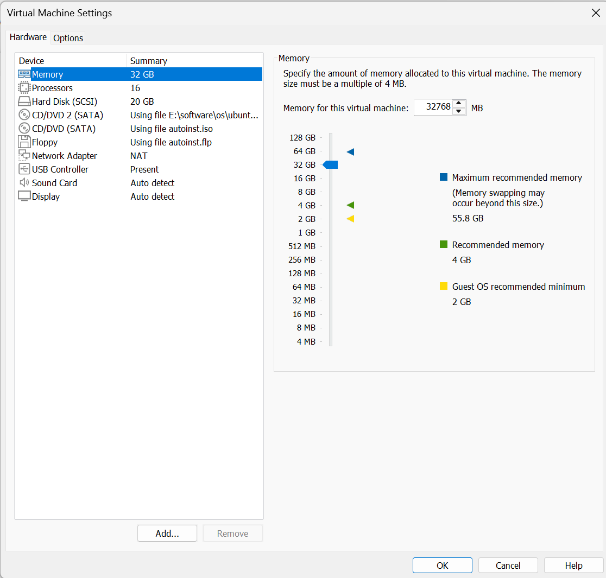

Press <OK> key to finish settings.

Start the virtual machine and wait for the GUI of Ubuntu Installation.

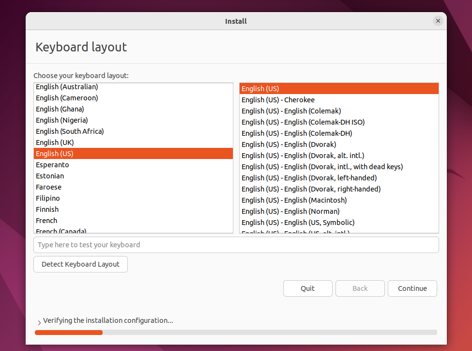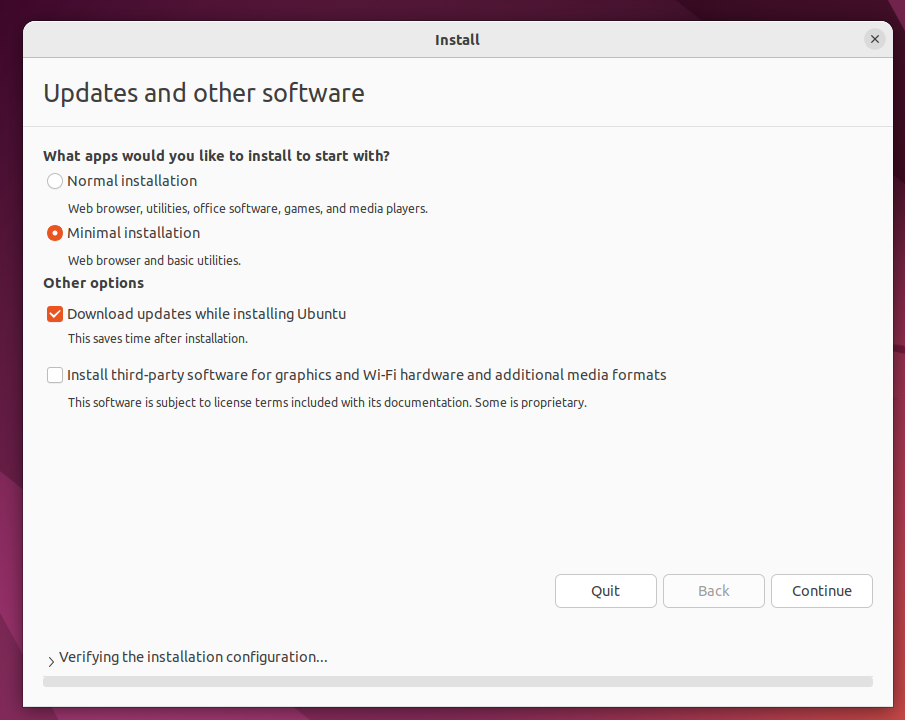

**NOTE: Select ENGLISH as the language, do not use Chinese as the system language.**

Then select **"Minimal Installation"** after select system language.

After that, press "Install Now" to continue, 

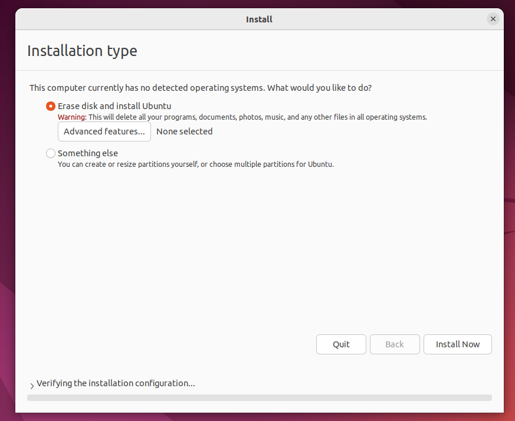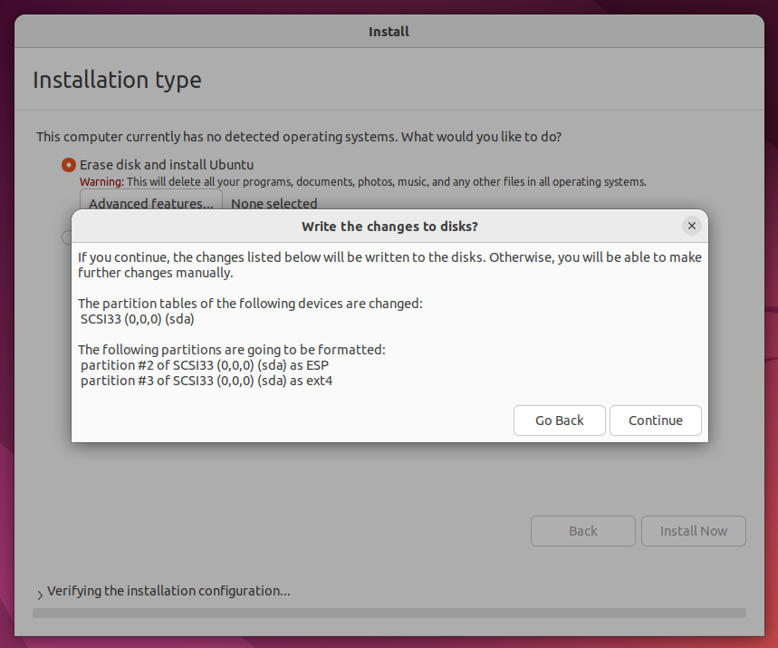

When be asked if to write the changes to disks, press "Continue" key to go on. 

At the end of installation, reboot the VM.

After reboot, the Ubuntu Linux will ask you to upgrade to Ubuntu 24.04.x LTS, select "Don't Upgrade".


### 1.4 Installing some useful tools

Press "CTRL" + "ALT" + "T" key to open a Linux terminal, then input following commands to install "vim", "git" and "pip":

```shell
sudo apt update
sudo apt upgrade
sudo apt install vim git python3-pip curl
```

Here "vim" is a text edit tool in Linux terminal, and "git" is a source version control tool, we will use it to clone source code from remote repositories. "python3-pip" is the package manager for python. 

Recently, "uv" is getting popular for managing python packages and virtual environment. You can install uv package manager by:

``` shell
curl -LsSf https://astral.sh/uv/install.sh | sh
```

Verify your installation by:

```
uv --version
```

If uv command is not found, adding path `~/.local/bin` to system variable "PATH"

Brief usage of "uv" is described here:

[How to manage python package using uv](./how-to-manage-python-package-through-uv.md) 


### 1.5 Installing Visual Studio Code

Under linux system, you can use both vim or VSCode to input your verilog code. But VSCode is more suitable for managing a multiple-file project. You can download VSCode installation pack in:

[https://code.visualstudio.com/](https://code.visualstudio.com/)

Use firefox browser under linux to access the homepage, the webpage will identify your system type (linux) and will provide you a download link of an install pack for linux system.  Choose "Linux x64 stable .deb" to download. See below.

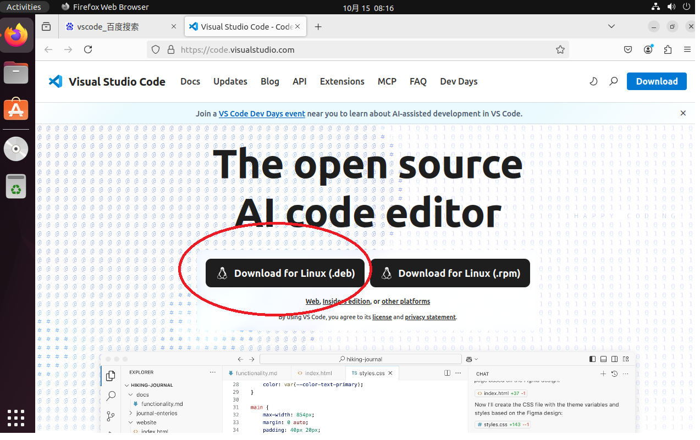

After downloaded, in terminal use

```
sudo dpkg -i code_xxxxx.deb
```

to install VSCode.

After finished steps above, some VSCode extensions should also be installed:

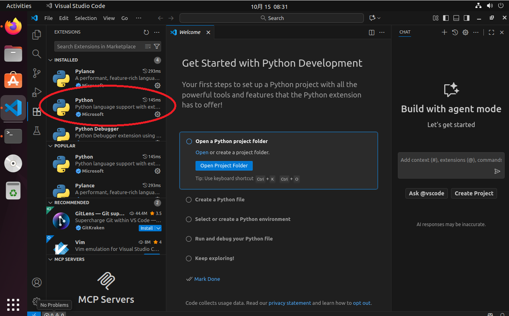


### 1.6 Installing PyTorch

Use a browser(any, under Linux or Windows) to open PyTorch main page:

[https://pytorch.org](https://pytorch.org)

Click "Get started" button to jump to the installation page.

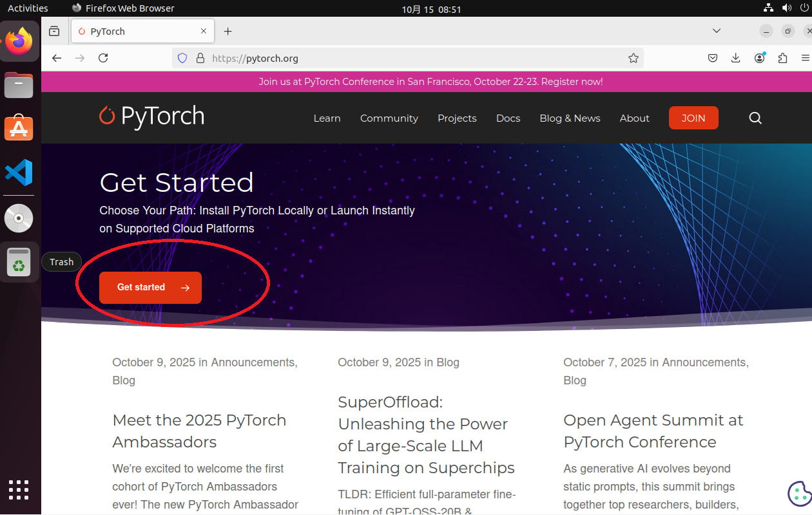

At the beginning, we don't need GPU acceleration. To avoid complicated configuration on GPU environment, we can use CPU version of PyTorch.

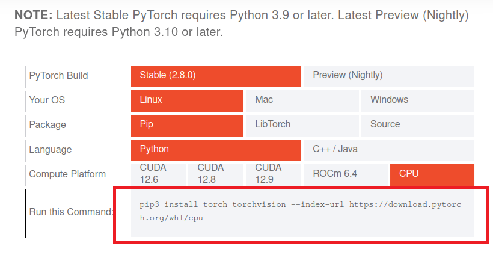

According to our experiment environment, choose OS option to "Linux", Package manager option to "Pip", Language option to "Python", and Compute Platform option to "CPU". Copy the script below and run it in the Linux Terminal.

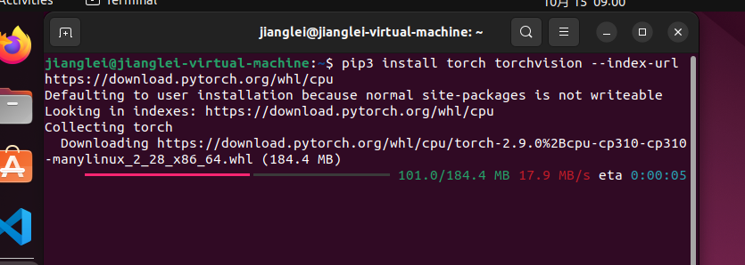

Wait for the installation to finish.

**NOTE: If you want to run PyTorch with VSCode, install  PyTorch under VSCode terminal.** 

As Python development tools under VSCode will automatic generate virtual environment, you need to install PyTorch separately  in VSCode terminal. Run following scripts in VSCode Terminal:

```
pip install torch torchvision --index-url https://download.pytorch.org/whl/cpu
```


### 1.7 Have a try for PyTorch

To ensure that PyTorch was installed correctly, we can verify the installation by running sample PyTorch code. Here we will construct a randomly initialized tensor.

```python
import torch
x = torch.rand(5, 3)
print(x)
```

The output should be something similar to:

```
tensor([[0.3380, 0.3845, 0.3217],
        [0.8337, 0.9050, 0.2650],
        [0.2979, 0.7141, 0.9069],
        [0.1449, 0.1132, 0.1375],
        [0.4675, 0.3947, 0.1426]])
```


## 2 Deploy on AGI platform of Tongji University(Optional, prepare for Course Projects)

https://agi.tongji.edu.cn/course/center


### 2.1 Resources

Tongji AGI platform provides containers for model training. 

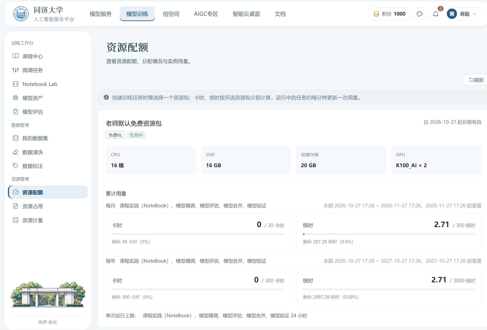

Key parameters:

- CPU: 16 cores
- RAM:16 GB
- Container storage: 20GB
- GPU: Hygon DCU K100_AIx2


### 2.2 Create an Instance

Open "https://agi.tongji.edu.cn/course/center". After login, choosing "模型训练" tab to enter the workbench.

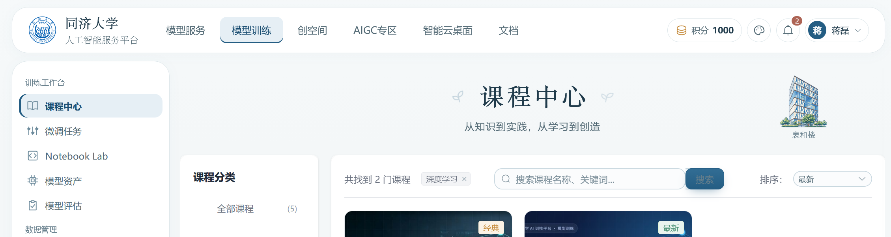


Click "课程中心" on the left, select "深度学习" in "课程分类" category, shows up 2 courses.

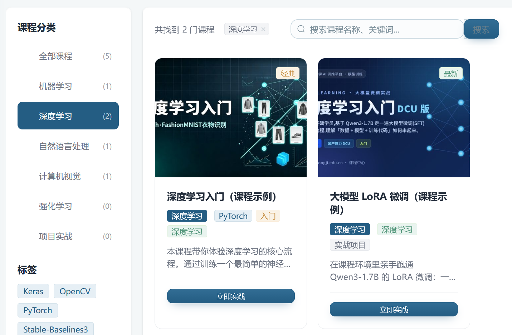

“深度学习入门” only use CPU to train, while "大模型LoRA微调" will instantiate 1 GPU for high load computation. **These courses will soon be updated, as I am working together with Information Center to introduce this course on site.**

 Click "立即实践" to open Startup page as following:

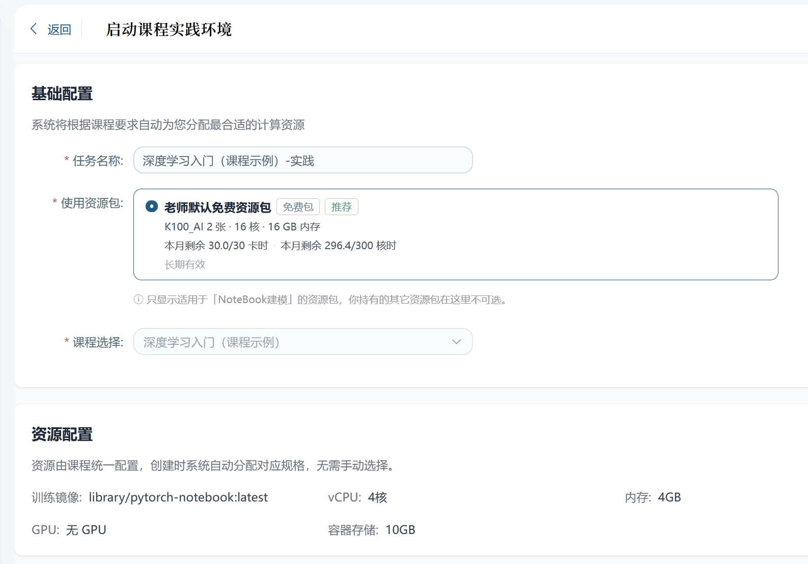

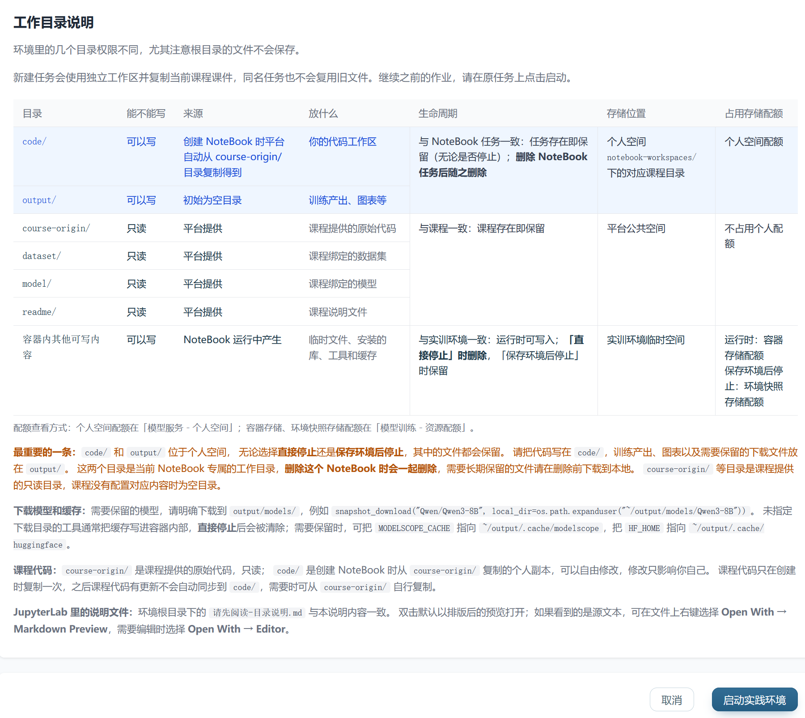

Read these instructions carefully. Click "启动实践环境" button to start. At this step, your GPU docker instance has been successfully started.

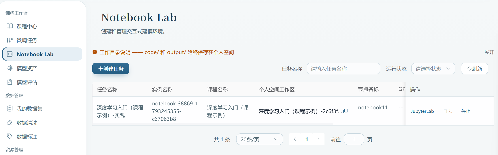

Click "JupyterLab" to open the webpage for online python development. You can also upload your python file and dataset to the remote GPU server.

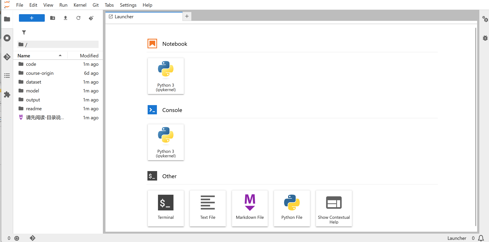

Recommend to use "Terminal" in JupyterLab to run system command and scripts.

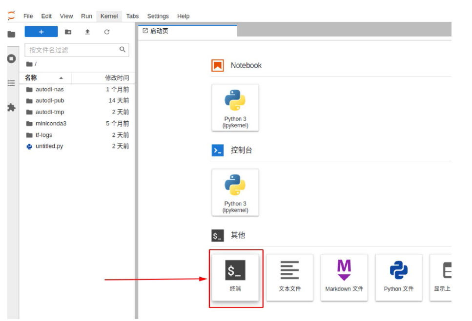

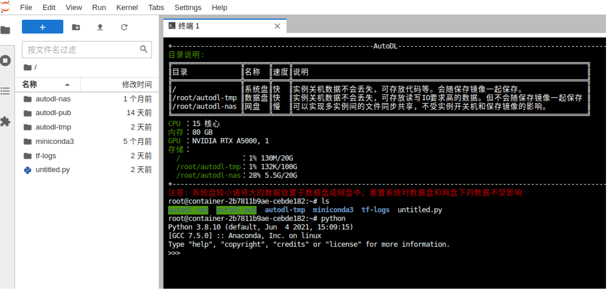

In terminal, you can run tasks that will take long time to finish. You can close your web browser while running. 

### 2.2 Usage Hints

To save the online hours of AGI platform, here are some hints:

- Use AGI platform only when huge computation is needed. Most examples in our experiments does not need GPU.
- Write your code in your local computer.  Upload your program to AGI platform only when you make sure that the program works.
- Don't forget to close your instantiation of container after your work.


## 3 Some Test Examples

### 3.1 Typical PyTorch workflow 

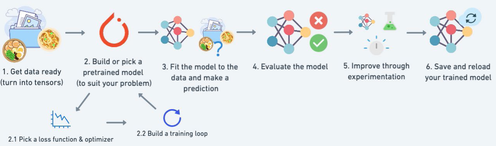

### 3.2 A simple MLP/FNN training example

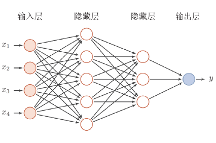

[mlp_fnn.py](../examples/0_mlp_fnn/mlp_fnn.py)


### 3.3 Linear Regression Example

Before running this example, additional python libraries need to be installed.

If you intended to develop python under VSCode, run following script under VSCode terminal.

```
pip install matplotlib
```

If you intended to run under Linux terminal, install python libs for system-wide environment.

```
python3-pip install matplotlib
```

The python source file can be get here:

[linear_regression.py](../examples/0_linear_regression/linear_regression.py)


Concepts:

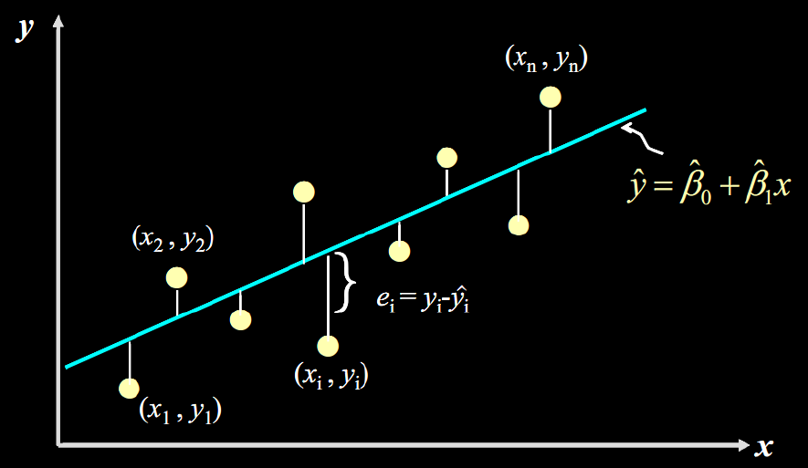

result:

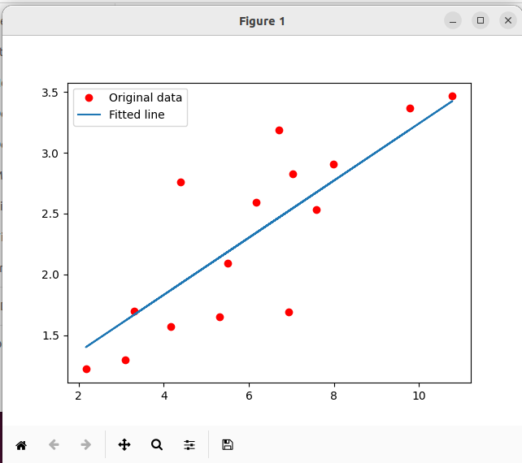


### 3.4 Logistic Regression

Concept:

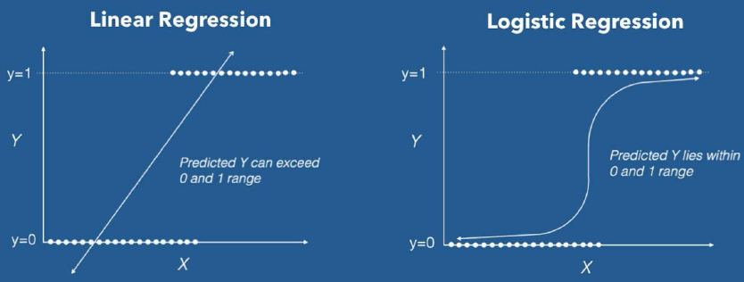

Code:

[log_regression.py](../examples/0_log_regression/log_regression.py)


### 3.5 PyTorch Classification(ResNet, on MNIST dataset)

Before using this example, install some python libraries under VSCode terminal.

```
pip install pytorch-lightning
pip install scikit-learn
```

This example need lots of computation, it will take more than 1 day on i7-13700K desktop CPU. Even 2070S GPU will take about 4 hours to train. Use GPU to accelerate the training progress.

[pt_class.py](../examples/0_resnet18/pt_class.py)

If you have GPU installed, it will gain 8~20x faster than pure CPU.


Reference

[CSDN]用pytorch中的resnet18实现mnist手写数字识别

 https://blog.csdn.net/qq_45869258/article/details/134467396


### 3.6 RNN, on MNIST dataset

Concept:

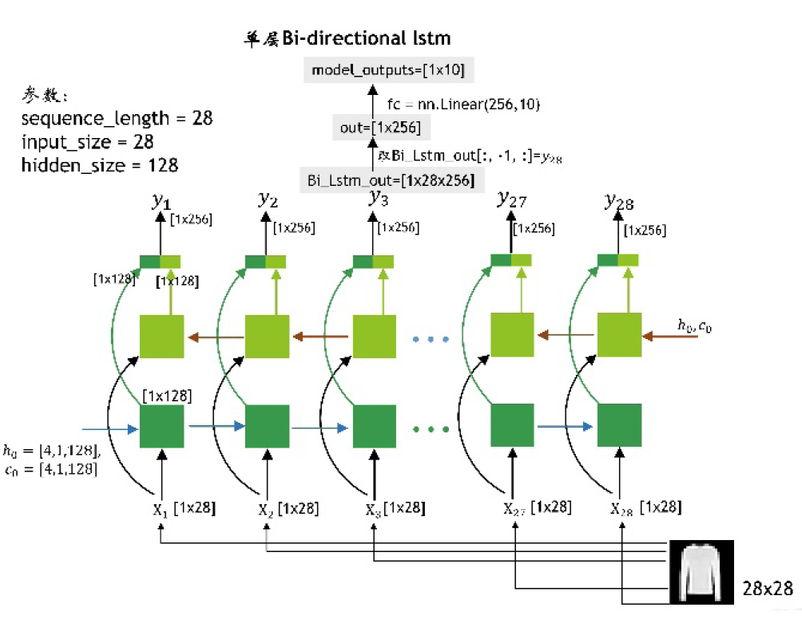

Reference Code:

[rnn.py](../examples/0_rnn/rnn.py)


### 3.6 CNN, on MNIST dataset

Concept:

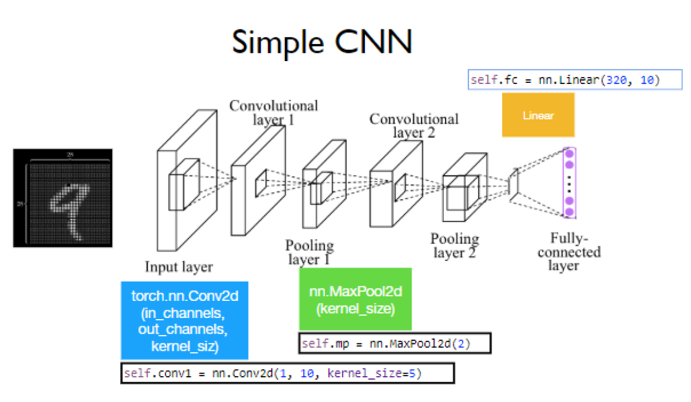

Reference Code:

[cnn.py](../examples/0_cnn/cnn.py)


### 3.7 GAN

Concept:

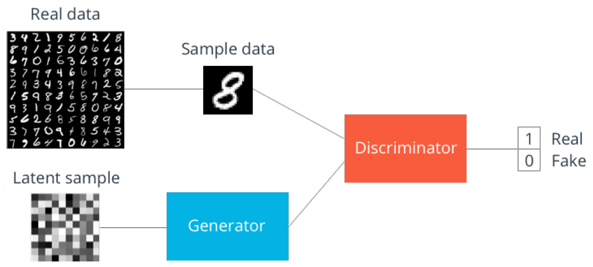

Reference Code:

[gan.py](../examples/0_gan/gan.py)


### 3.8 VAE

Concepts:

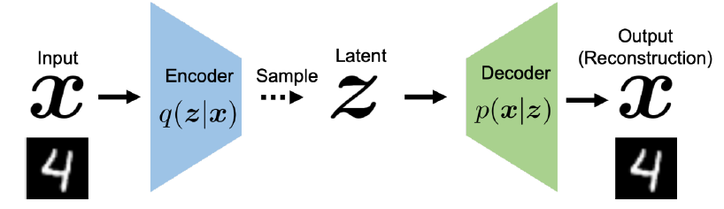

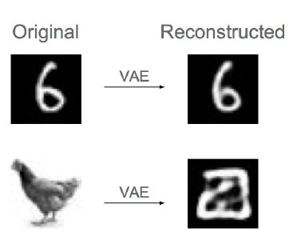

Reference Code:

[vae.py](../examples/0_vae/vae.py)


