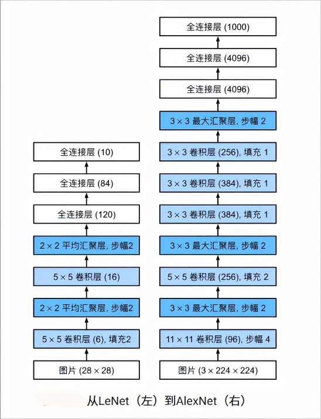
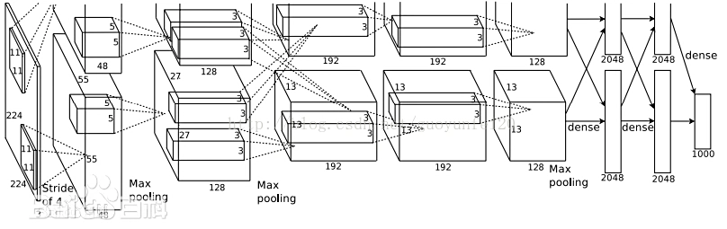
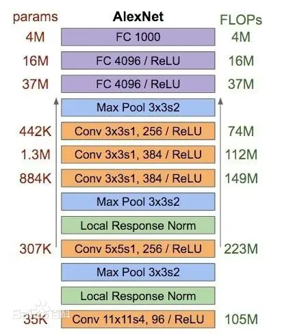
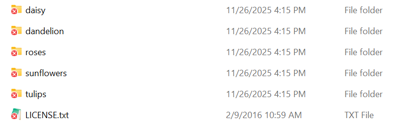
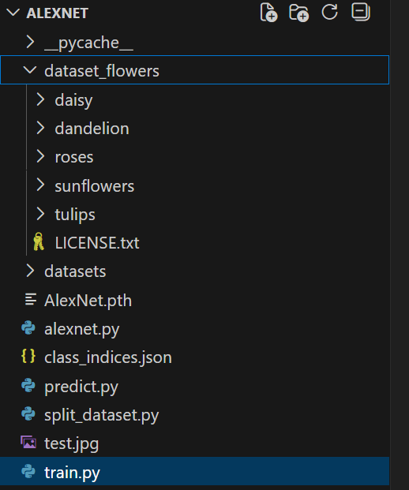
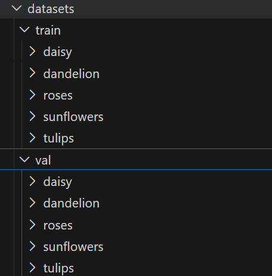
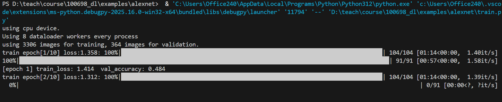
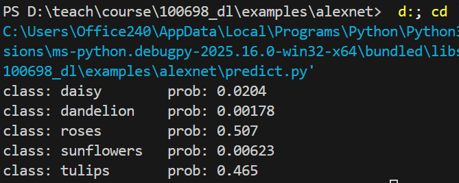

# EXP2 CNN Applications: AlexNet


## 1 About AlexNet

### 1.1 Background

AlexNet is a deep convolutional neural network(D-CNN) first introduced by Alex Krizhevsky, Ilya Sutskever, and Geoffrey Hinton in 2012 at the ImageNet image classification competition. This competition is a vast dataset containing over 1 million images and 1000 different categories. AlexNet was the first deep learning model to achieve the best results on the ImageNet dataset. This experiment will provide a detailed introduction to the structure and training process of AlexNet.

##### Difference between LeNet5 and AlexNet

- AlexNet is deeper than LeNet5. AlexNet consists of 8 layers: 5 convolutional layers, 2 fully connected hidden layers, and 1 fully connected output layer.

  - The size of 1st Conv Window is 11×11.

  - The size of 2nd Conv Window is 5×5.

  - The size of 3rd/4th/5th Conv Window is 3×3.

  - After Conv Window 1/2/5, use Max-pooling layer with 3x3 window size and 2 steps

  - AlexNet has 10x convolution channels than LeNet.

- AlexNet uses ReLU(Rectified Linear Unit) activation function, as:
  - ReLU is simpler in numerical calculations, no exponential operation needed.
  - The ReLU activation function makes the model easier to train under different parameter initialization methods. This is because when the output of the sigmoid activation function is very close to 0 or 1, the gradient in these areas is almost 0, which prevents backpropagation from continuing to update some model parameters. However, the gradient of the ReLU activation function is always 1 in the positive interval. Therefore, if the model parameters are not initialized properly, the sigmoid function may obtain a gradient of almost 0 in the positive interval, making it impossible for the model to be effectively trained.

- AlexNet controls the model complexity of the fully connected layer through **Dropout**. However, LeNet does not. Dropout method will prevent over-fitting in training process.

  

### 1.2 Implementation Structure




##### Structure of AlexNet



### 1.3 Cost Analysis

Parameters and FLOPs on each layer:



### 1.4 Applications

- Image Classification
- Visual Recognition


## 2 Experiment on AlexNet

### 2.1 Purpose of Experiment

- Get familiar to the procedures of generic CNN application.

- Understanding how AlexNet is trained and do some predict work.

- Observe the impact of different training parameters.

  

### 2.2 Preparation

#### 2.2.1 Prepare some python libs

Some additional libraries will be needed during experiment. In VSCode terminal, executing following commands to install with pip.

```
pip install numpy tqdm matplotlib PyQt5
```

- numpy: numeric computing lib, for some matrix calculation
- tqdm: lib to display progress bar in terminal
- matplotlib: lib to display curves and images
- PyQt5: back-end of matplotlib


#### 2.2.2 Download flower datasets

The flower dataset consists of 3670 sample pictures. These pics are classified into 5 categories.

Download the flower dataset from following link:

[flower_photos.tgz](https://github.com/warner-ng/tongji-deep-learning/releases/download/course-assets-2026/flower_photos.tgz)

Extract the .tgz file, and rename the sub-folder to "dataset_flowers". Move the "dataset_flowers" to where your python code locates. The folder struct should look like this:




#### 2.2.3 Split datasets into subsets

Before using these pictures, you need to randomly select some samples and split them into train_set, validation_set. Using following python scripts to randomly get pics into different set.

```python
import os
from shutil import copy, rmtree
import random


def mk_file(file_path: str):
    if os.path.exists(file_path):
        # if the folder exists, delete it and create a new one
        rmtree(file_path)
    os.makedirs(file_path)

if __name__ == '__main__':
    # ensure reproducibility
    random.seed(0)

    # split 10% of the dataset into the validation set
    split_rate = 0.1

    # point to your unzipped flower_photos folder
    cwd = os.getcwd()
    data_root = os.path.join(cwd, "datasets")
    origin_flower_path = os.path.join(cwd, "dataset_flowers")
    assert os.path.exists(origin_flower_path), "path '{}' does not exist.".format(origin_flower_path)

    flower_class = [cla for cla in os.listdir(origin_flower_path)
                    if os.path.isdir(os.path.join(origin_flower_path, cla))]

    # create folders for train sets
    train_root = os.path.join(data_root, "train")
    mk_file(train_root)
    for cla in flower_class:
        # create folder for each class
        mk_file(os.path.join(train_root, cla))

    # create folders for validation sets
    val_root = os.path.join(data_root, "val")
    mk_file(val_root)
    for cla in flower_class:
        # create folder for each class
        mk_file(os.path.join(val_root, cla))

    for cla in flower_class:
        cla_path = os.path.join(origin_flower_path, cla)
        images = os.listdir(cla_path)
        num = len(images)
        # random sampling
        eval_index = random.sample(images, k=int(num*split_rate))
        for index, image in enumerate(images):
            if image in eval_index:
                # copy files assigned to validation set to corresponding directory
                image_path = os.path.join(cla_path, image)
                new_path = os.path.join(val_root, cla)
                copy(image_path, new_path)
            else:
                # copy files assigned to training set to corresponding directory
                image_path = os.path.join(cla_path, image)
                new_path = os.path.join(train_root, cla)
                copy(image_path, new_path)
            print("\r[{}] processing [{}/{}]".format(cla, index+1, num), end="")  # processing bar
        print()

    print("processing done!")
```

Here we proposed to randomly choose 10% samples as the validation set. The remaining samples will be copied to training set.

After executing this script, it will generate a new folder named with "datasets" in your project folder, with 2 sub folder "train" and "val". Some pictures in original dataset folder will be copied into these 2 folders. The dataset for training will be looked like followings:




### 2.3 Procedures

#### 2.3.1 Prepare the AlexNet implementation

The implementation of AlexNet is showed as following scripts:

```python
# alexnet.py
import torch.nn as nn
import torch
 
 
class AlexNet(nn.Module):
    def __init__(self, num_classes=1000, init_weights=False):
        super(AlexNet, self).__init__()
        self.features = nn.Sequential(
            nn.Conv2d(3, 48, kernel_size=11, stride=4, padding=2),  # input[3, 224, 224] -> [48, 55, 55]
            nn.ReLU(inplace=True),
            nn.MaxPool2d(kernel_size=3, stride=2),                  # -> [48, 27, 27]
            nn.Conv2d(48, 128, kernel_size=5, padding=2),           # -> [128, 27, 27]
            nn.ReLU(inplace=True),
            nn.MaxPool2d(kernel_size=3, stride=2),                  # -> [128, 13, 13]
            nn.Conv2d(128, 192, kernel_size=3, padding=1),          # -> [192, 13, 13]
            nn.ReLU(inplace=True),
            nn.Conv2d(192, 192, kernel_size=3, padding=1),          # -> [192, 13, 13]
            nn.ReLU(inplace=True),
            nn.Conv2d(192, 128, kernel_size=3, padding=1),          # -> [128, 13, 13]
            nn.ReLU(inplace=True),
            nn.MaxPool2d(kernel_size=3, stride=2),                  # -> [128, 6, 6]
        )
        self.classifier = nn.Sequential(
            nn.Dropout(p=0.5),
            nn.Linear(128 * 6 * 6, 2048),
            nn.ReLU(inplace=True),
            nn.Dropout(p=0.5),
            nn.Linear(2048, 2048),
            nn.ReLU(inplace=True),
            nn.Linear(2048, num_classes),
        )
        if init_weights:
            self._initialize_weights()
 
    def forward(self, x):
        x = self.features(x)
        x = torch.flatten(x, start_dim=1)
        x = self.classifier(x)
        return x
 
    def _initialize_weights(self):
        for m in self.modules():
            if isinstance(m, nn.Conv2d):
                nn.init.kaiming_normal_(m.weight, mode='fan_out', nonlinearity='relu')
                if m.bias is not None:
                    nn.init.constant_(m.bias, 0)
            elif isinstance(m, nn.Linear):
                nn.init.normal_(m.weight, 0, 0.01)
                nn.init.constant_(m.bias, 0)
                
```

Save these scripts with the name of **alexnet.py**.

Event there is implemented function of AlexNet in torchvision lib(see https://pytorch.org/hub/pytorch_vision_alexnet/), the upper script will help you to build up your own CNN implementation.


#### 2.3.2 Prepare the training procedure

```python
import os
import sys
import json

import torch
import torch.nn as nn
from torchvision import transforms, datasets, utils
import matplotlib.pyplot as plt
import numpy as np
import torch.optim as optim
from tqdm import tqdm

from alexnet import AlexNet


if __name__ == '__main__':
    device = torch.device("cuda:0" if torch.cuda.is_available() else "cpu")
    print("using {} device.".format(device))

    data_transform = {
        "train": transforms.Compose([transforms.RandomResizedCrop(224),
                                     transforms.RandomHorizontalFlip(),
                                     transforms.ToTensor(),
                                     transforms.Normalize((0.5, 0.5, 0.5), (0.5, 0.5, 0.5))]),
        "val": transforms.Compose([transforms.Resize((224, 224)),  # cannot 224, must (224, 224)
                                   transforms.ToTensor(),
                                   transforms.Normalize((0.5, 0.5, 0.5), (0.5, 0.5, 0.5))])}

    
    image_path = os.path.join(os.getcwd(), "datasets")  # flower data set path
    assert os.path.exists(image_path), "{} path does not exist.".format(image_path)
    train_dataset = datasets.ImageFolder(root=os.path.join(image_path, "train"),
                                         transform=data_transform["train"])
    train_num = len(train_dataset)

    # {'daisy':0, 'dandelion':1, 'roses':2, 'sunflower':3, 'tulips':4}
    flower_list = train_dataset.class_to_idx
    cla_dict = dict((val, key) for key, val in flower_list.items())
    # write dict into json file
    json_str = json.dumps(cla_dict, indent=4)
    with open('class_indices.json', 'w') as json_file:
        json_file.write(json_str)

    batch_size = 32
    nw = min([os.cpu_count(), batch_size if batch_size > 1 else 0, 8])  # number of workers
    print('Using {} dataloader workers every process'.format(nw))

    train_loader = torch.utils.data.DataLoader(train_dataset,
                                               batch_size=batch_size, shuffle=True,
                                               num_workers=nw)

    validate_dataset = datasets.ImageFolder(root=os.path.join(image_path, "val"),
                                            transform=data_transform["val"])
    val_num = len(validate_dataset)
    validate_loader = torch.utils.data.DataLoader(validate_dataset,
                                                  batch_size=4, shuffle=False,
                                                  num_workers=nw)

    print("using {} images for training, {} images for validation.".format(train_num,
                                                                           val_num))
    # test_data_iter = iter(validate_loader)
    # test_image, test_label = test_data_iter.next()
    #
    # def imshow(img):
    #     img = img / 2 + 0.5  # unnormalize
    #     npimg = img.numpy()
    #     plt.imshow(np.transpose(npimg, (1, 2, 0)))
    #     plt.show()
    #
    # print(' '.join('%5s' % cla_dict[test_label[j].item()] for j in range(4)))
    # imshow(utils.make_grid(test_image))

    net = AlexNet(num_classes=5, init_weights=True)

    net.to(device)
    loss_function = nn.CrossEntropyLoss()
    # pata = list(net.parameters())
    optimizer = optim.Adam(net.parameters(), lr=0.0002)

    epochs = 10
    save_path = './AlexNet.pth'
    best_acc = 0.0
    train_steps = len(train_loader)
    for epoch in range(epochs):
        # train
        net.train()
        running_loss = 0.0
        train_bar = tqdm(train_loader, file=sys.stdout)
        for step, data in enumerate(train_bar):
            images, labels = data
            optimizer.zero_grad()
            outputs = net(images.to(device))
            loss = loss_function(outputs, labels.to(device))
            loss.backward()
            optimizer.step()

            # print statistics
            running_loss += loss.item()

            train_bar.desc = "train epoch[{}/{}] loss:{:.3f}".format(epoch + 1,
                                                                     epochs,
                                                                     loss)

        # validate
        net.eval()
        acc = 0.0  # accumulate accurate number / epoch
        with torch.no_grad():
            val_bar = tqdm(validate_loader, file=sys.stdout)
            for val_data in val_bar:
                val_images, val_labels = val_data
                outputs = net(val_images.to(device))
                predict_y = torch.max(outputs, dim=1)[1]
                acc += torch.eq(predict_y, val_labels.to(device)).sum().item()

        val_accurate = acc / val_num
        print('[epoch %d] train_loss: %.3f  val_accuracy: %.3f' %
              (epoch + 1, running_loss / train_steps, val_accurate))

        if val_accurate > best_acc:
            best_acc = val_accurate
            torch.save(net.state_dict(), save_path)

    print('Finished Training')
```

Save these scripts with the name of **train.py**.

#### 2.3.3 Training the network

Run the training progress in VSCode. You can see the progress of each epoch.



If you are developing under Linux Terminal, run shell script like following:

```
python3 train.py
```

In CPU only environment, the procedure of training 10 epochs will take about 10~15 minutes on a 8-core laptop CPU(e.g. AMD Ryzen7 7840HS).

After successfully training, it will generate a parameter file name with **AlexNet.pth**. Then we can use this parameter to let the CPU do some recognition work.


### 2.4 Prepare for predict

Using generated weight for prediction. Using following scripts to run prediction procedure:

```python
import os
import json

import torch
from PIL import Image
from torchvision import transforms
import matplotlib.pyplot as plt

from alexnet import AlexNet


if __name__ == '__main__':
    device = torch.device("cuda:0" if torch.cuda.is_available() else "cpu")

    data_transform = transforms.Compose(
        [transforms.Resize((224, 224)),
         transforms.ToTensor(),
         transforms.Normalize((0.5, 0.5, 0.5), (0.5, 0.5, 0.5))])

    # load image
    img_path = "./test.jpg"
    assert os.path.exists(img_path), "file: '{}' dose not exist.".format(img_path)
    img = Image.open(img_path)

    plt.imshow(img)
    # [N, C, H, W]
    img = data_transform(img)
    # expand batch dimension
    img = torch.unsqueeze(img, dim=0)

    # read class_indict
    json_path = './class_indices.json'
    assert os.path.exists(json_path), "file: '{}' dose not exist.".format(json_path)

    with open(json_path, "r") as f:
        class_indict = json.load(f)

    # create model
    model = AlexNet(num_classes=5).to(device)

    # load model weights
    weights_path = "./AlexNet.pth"
    assert os.path.exists(weights_path), "file: '{}' dose not exist.".format(weights_path)
    model.load_state_dict(torch.load(weights_path))

    model.eval()
    with torch.no_grad():
        # predict class
        output = torch.squeeze(model(img.to(device))).cpu()
        predict = torch.softmax(output, dim=0)
        predict_cla = torch.argmax(predict).numpy()

    print_res = "class: {}   prob: {:.3}".format(class_indict[str(predict_cla)],
                                                 predict[predict_cla].numpy())
    plt.title(print_res)
    for i in range(len(predict)):
        print("class: {:10}   prob: {:.3}".format(class_indict[str(i)],
                                                  predict[i].numpy()))
    plt.show()

```

Save these scripts with the name of **predict.py**.

### 2.5 Expect Results

Before running prediction, choose a picture randomly from original dataset, and rename it to "test.jpg".  Here I choose  a picture of tulip.


After running predict script, you will get result like:



Here is the list of classify probabilities. Here you can see that the highest probability is roses(0.507), and followed by tulips(0.465). You can try different samples to evaluate the result.


## 3 Extra Work

- Modify the train.py to record the "train loss" and "val_accuracy" data. Increase the number of epochs(e.g. from 10 epochs to 20/50/100). Observe the trend of "train loss" and "val_accuracy". Analyze the reason, and find some reference to support your opinion.

- Modify split.py, randomly pick out only 50% samples as training set, 10% as validation set, do a training procedure of 10 epochs. As each time the split work will choose different samples, try 3~5 rounds of training by using different training sets. Observe if there is statistical difference on "train loss" and "val_accuracy".

  

## 4 Reference

Krizhevsky A, Sutskever I, Hinton G E. ImageNet  classification with deep convolutional neural networks[C]//  International Conference on Neural Information Processing Systems.  Curran Associates Inc. 2012:1097-1105.

https://www.bilibili.com/video/BV1W7411T7qc

https://github.com/WZMIAOMIAO/deep-learning-for-image-processing

https://blog.csdn.net/q6115759/article/details/130739086

https://www.cnblogs.com/keye/p/17501664.html

https://developer.aliyun.com/article/1209991

[CSDN: AlexNet的简单解析并实现分类训练预测操作](https://blog.csdn.net/ai12345678900008/article/details/152515589)

[CSDN: Pytorch nn.Module详解](https://blog.csdn.net/fydw_715/article/details/145720650)

[CSDN: PyTorch 和nn.Conv2d详解](https://blog.csdn.net/qq_36812406/article/details/151366472)


