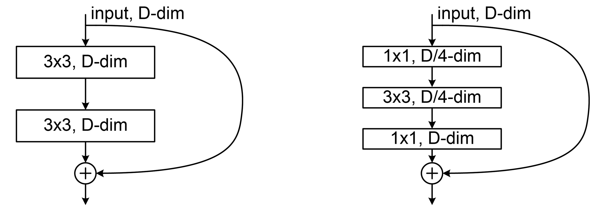
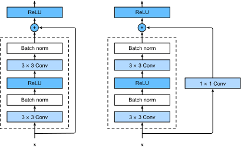
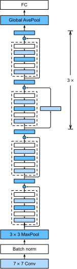
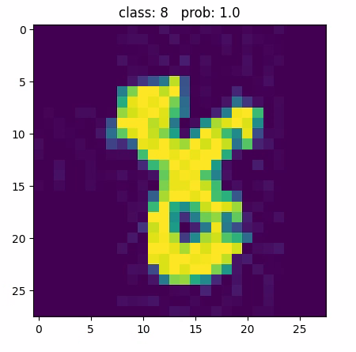
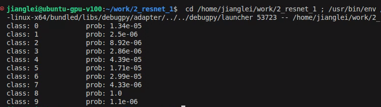

# EXP3 CNN Application 2: ResNet

## 0 Introduction

### 0.1 Purpose of Experiments

- Learn to construct ResNet from building blocks.

- Evaluate the performance of ResNet, comparing with  previous AlexNet in image classification applications.
- Setup your own workflow, including dataset pre-conditioning, training, prediction and performance analyze.

### 0.2 Questions and Practices

**Q1:** By reading the implementation code of ResNet, draw a block diagram of ResNet34, ResNet50 and ResNet101. The chart follows the format of Figure 3.

**Q2:** Add code in "train.py" to record the trend of **train_loss** and **val_accuracy** result in each training epoch. Using the same dataset of flowers, evaluate the performance comparing with AlexNet. 

**Q3:** What is the difference between applying pre-trained weight and training from scratch? Give some evidence to support your answer.


## 1 About ResNet

### 1.1 Introduction

A **residual neural network** (also referred to as a **residual network** or **ResNet**)[[1\]](https://en.wikipedia.org/wiki/Residual_neural_network#cite_note-resnet-1) is a [deep learning](https://en.wikipedia.org/wiki/Deep_learning) architecture in which the layers learn residual functions with reference to the layer inputs. It was developed in 2015 for [image recognition](https://en.wikipedia.org/wiki/Image_recognition), and won the [ImageNet](https://en.wikipedia.org/wiki/ImageNet) Large Scale Visual Recognition Challenge ([ILSVRC](https://image-net.org/challenges/LSVRC/)) of that year.

As a point of terminology, "residual connection" refers to the specific architectural motif of   

, 

where  is an arbitrary neural network module. The motif had been used previously (see [§History](https://en.wikipedia.org/wiki/Residual_neural_network#History) for details). However, the publication of ResNet made it widely popular for [feedforward networks](https://en.wikipedia.org/wiki/Feedforward_neural_network), appearing in neural networks that are seemingly unrelated to ResNet.

The residual connection stabilizes the training and convergence  of deep neural networks with hundreds of layers, and is a common motif  in deep neural networks, such as [transformer](https://en.wikipedia.org/wiki/Transformer_(deep_learning_architecture)) models (e.g., [BERT](https://en.wikipedia.org/wiki/BERT_(language_model)), and [GPT](https://en.wikipedia.org/wiki/Generative_pre-trained_transformer) models such as [ChatGPT](https://en.wikipedia.org/wiki/ChatGPT)), the [AlphaGo Zero](https://en.wikipedia.org/wiki/AlphaGo_Zero) system, the [AlphaStar](https://en.wikipedia.org/wiki/AlphaStar_(software)) system, and the [AlphaFold](https://en.wikipedia.org/wiki/AlphaFold) system.

### 1.2 Building blocks

Two variants of convolutional Residual Blocks.[[1\]](https://en.wikipedia.org/wiki/Residual_neural_network#cite_note-resnet-1) **Left**: a *basic block* that has two 3x3 convolutional layers. **Right**: a *bottleneck block* that has a 1x1 convolutional layer for dimension reduction, a 3x3  convolutional layer, and another 1x1 convolutional layer for dimension  restoration.



<center>Figure 1. Structure of Residual Block and Bottleneck Block</center>

Block diagram of ResNet (2015). It shows a ResNet block with and without the 1x1 convolution. The 1x1 convolution (with stride) can be used to  change the shape of the array, which is necessary for residual  connection through an up sampling/down sampling layer.



<center>Figure 2. Residual Block without/with down sampling layer</center>

Following diagram shows the structure of the simplest ResNet-18, 



<center>Figure 3. Implementation of ResNet-18</center>

### 1.3 Implementation

Here is the implementation of basic block, you need to complete the code:

```python
class BasicBlock(nn.Module):
    expansion = 1

    def __init__(self, in_channel, out_channel, stride=1, downsample=None, **kwargs):
        super(BasicBlock, self).__init__()
        self.conv1 = nn.Conv2d(in_channels=in_channel, out_channels=out_channel,
                               kernel_size=3, stride=stride, padding=1, bias=False)
        self.bn1 = nn.BatchNorm2d(out_channel)
        self.relu = nn.ReLU()
        self.conv2 = nn.Conv2d(in_channels=out_channel, out_channels=out_channel,
                               kernel_size=3, stride=1, padding=1, bias=False)
        self.bn2 = nn.BatchNorm2d(out_channel)
        self.downsample = downsample

    def forward(self, x):
        identity = x
        if self.downsample is not None:
            identity = self.downsample(x)

		# TODO: according to structure shown in Figure 2., Fulfill the implementation code here.
        # Here the object "x" is the input tensor
        out = 
        out = 
        out = 
        
        out = 
        out =
        
        # generating residual here, object "identity" will be original input tensor or down-sampled tensor according to the option "downsample"
        out +=
        out = 

        return out
```

implementation of bottleneck block:

```python
class Bottleneck(nn.Module):
    expansion = 4

    def __init__(self, in_channel, out_channel, stride=1, downsample=None,
                 groups=1, width_per_group=64):
        super(Bottleneck, self).__init__()
        width = int(out_channel * (width_per_group / 64.)) * groups
        
        # squeeze channels
        # conv1 is the 1x1 convolutional layer for dimension reduction 
        self.conv1 = nn.Conv2d(in_channels=in_channel, out_channels=width, kernel_size=1, stride=1, bias=False)  
        self.bn1 = nn.BatchNorm2d(width)
        # -----------------------------------------
        self.conv2 = nn.Conv2d(in_channels=width, out_channels=width, groups=groups, kernel_size=3, stride=stride, bias=False, padding=1)
        self.bn2 = nn.BatchNorm2d(width)
        # -----------------------------------------
        # unsqueeze channels
        # conv3 is the 1x1 convolutional layer for dimension restoration 
        self.conv3 = nn.Conv2d(in_channels=width, out_channels=out_channel*self.expansion, kernel_size=1, stride=1, bias=False)  
        # 
        self.bn3 = nn.BatchNorm2d(out_channel*self.expansion)
        self.relu = nn.ReLU(inplace=True)
        self.downsample = downsample

    def forward(self, x):
        identity = x
        if self.downsample is not None:
            identity = self.downsample(x)
            
		# TODO: according to structure of bottleneck block shown in Figure 1. and the implementation block in Figure 2., Fulfill the implementation code here.
        # Here the object "x" is the input tensor
        
        out = 
        out = 
        out = 

        out = 
        out = 
        out = 

        out = 
        out = 

        out += 
        out = 

        return out
```

Implementation of ResNet:

```python
class ResNet(nn.Module):

    def __init__(self,
                 block,
                 blocks_num,
                 num_classes=1000,
                 include_top=True,
                 groups=1,
                 width_per_group=64):
        super(ResNet, self).__init__()
        self.include_top = include_top
        self.in_channel = 64

        self.groups = groups
        self.width_per_group = width_per_group

        self.conv1 = nn.Conv2d(3, self.in_channel, kernel_size=7, stride=2,
                               padding=3, bias=False)
        self.bn1 = nn.BatchNorm2d(self.in_channel)
        self.relu = nn.ReLU(inplace=True)
        self.maxpool = nn.MaxPool2d(kernel_size=3, stride=2, padding=1)
        self.layer1 = self._make_layer(block, 64, blocks_num[0])
        self.layer2 = self._make_layer(block, 128, blocks_num[1], stride=2)
        self.layer3 = self._make_layer(block, 256, blocks_num[2], stride=2)
        self.layer4 = self._make_layer(block, 512, blocks_num[3], stride=2)
        if self.include_top:
            self.avgpool = nn.AdaptiveAvgPool2d((1, 1))  # output size = (1, 1)
            self.fc = nn.Linear(512 * block.expansion, num_classes)

        for m in self.modules():
            if isinstance(m, nn.Conv2d):
                nn.init.kaiming_normal_(m.weight, mode='fan_out', nonlinearity='relu')

    def _make_layer(self, block, channel, block_num, stride=1):
        downsample = None
        if stride != 1 or self.in_channel != channel * block.expansion:
            downsample = nn.Sequential(
                nn.Conv2d(self.in_channel, channel * block.expansion, kernel_size=1, stride=stride, bias=False),
                nn.BatchNorm2d(channel * block.expansion))

        layers = []
        layers.append(block(self.in_channel,
                            channel,
                            downsample=downsample,
                            stride=stride,
                            groups=self.groups,
                            width_per_group=self.width_per_group))
        self.in_channel = channel * block.expansion

        for _ in range(1, block_num):
            layers.append(block(self.in_channel,
                                channel,
                                groups=self.groups,
                                width_per_group=self.width_per_group))

        return nn.Sequential(*layers)

    def forward(self, x):
        x = self.conv1(x)
        x = self.bn1(x)
        x = self.relu(x)
        x = self.maxpool(x)

        x = self.layer1(x)
        x = self.layer2(x)
        x = self.layer3(x)
        x = self.layer4(x)

        if self.include_top:
            x = self.avgpool(x)
            x = torch.flatten(x, 1)
            x = self.fc(x)

        return x
```


## 2 Training ResNet weight with pre-trained weight

### 2.1 Prepare dataset

We are using the previous dataset of flowers. Using "split.py" to divide all images into train-set and evaluation-set. 

### 2.2 Training with pre-trained weight

The training script can be acquired from following repository:

https://git.tongji.edu.cn/100698_dl/examples/-/tree/main/2_resnet_pretrain

Use `git clone` to get the copy of the project.

Some pre-trained ResNet weight can be acquired from Pytorch.org

ResNet34: https://download.pytorch.org/models/resnet34-333f7ec4.pth

ResNet50:https://download.pytorch.org/models/resnet50-19c8e357.pth

ResNet101:https://download.pytorch.org/models/resnet101-5d3b4d8f.pth

ResNet50_32x4d:https://download.pytorch.org/models/resnext50_32x4d-7cdf4587.pth

After downloaded, rename the file to simple name, or modify the file name in your code.

in `train.py ` line 65, the following code snippet shows how to load pre-trained weights into your resnet.

```python
    # load pre-trained weights
    net = resnet34()
    #assign the filename of pre-trained weight
    model_weight_path = "./resnet34-pre.pth"  
    assert os.path.exists(model_weight_path), "file {} does not exist.".format(model_weight_path)
    net.load_state_dict(torch.load(model_weight_path, map_location=device, weights_only=False))
    
    # change fc layer structure
    in_channel = net.fc.in_features
    net.fc = nn.Linear(in_channel, 5)
    net.to(device)
```

### 2.3 Tasks

- Add code to `train.py` to record **train_loss** and **val_accuracy** result in each epoch, save in csv file.

- In file of origin, the epoch is set to 3. Train the weight at default epoch rounds, randomly pick some sample images, predict with your model, compare with AlexNet result.


## 3 Training Your Own ResNet weight (without pre-trained weight)

### 3.1 Prepare dataset

Still using the previous dataset of flowers. Using "split.py" to divide all images into train-set and evaluation-set. 

### 3.2 Training your weight from scratch

Create a new work folder, then modify `train.py` to remove the loading of pre-trained weight. At line 65, remove `net.load_state_dict` part.

```python
    net = resnet34(num_classes=5, include_top=True)

    # for param in net.parameters():
    #     param.requires_grad = False

    # change fc layer structure
    in_channel = net.fc.in_features
    net.fc = nn.Linear(in_channel, 5)
    net.to(device)
```

### 3.3 Tasks

- Observe and compare the trend of **train_loss** and **val_accuracy** in each epoch. Find some reference to explain how pre-trained weight works.

- Try more rounds of training epoch (e.g. 10~20 rounds), make comparison.

  

## 4 Build up new ResNet workflow for MNIST dataset from scratch

### 4.1 Prepare dataset

MNIST dataset can be downloaded automatically, use following script to prepare dataset

https://git.tongji.edu.cn/100698_dl/examples/-/tree/main/2_resnet_mnist/download_mnist.py

This script will automatically download from Pytorch.org, then split training set and test set, in the similar folder structure like flowers_dataset.

### 4.2 Build up work flow

As MNIST has a smaller image size and in monochrome, images should be processed before sending to network. The following script gives reference params for pre-processing.

```python
    # data preprocessing
    data_transform = {
        "train": transforms.Compose([transforms.RandomResizedCrop(224),
                                     transforms.RandomHorizontalFlip(),
                                     transforms.ToTensor(),
                                     transforms.Normalize([0.485, 0.456, 0.406], [0.229, 0.224, 0.225])]),
        "val": transforms.Compose([transforms.Resize(256),
                                   transforms.CenterCrop(224),
                                   transforms.ToTensor(),
                                   transforms.Normalize([0.485, 0.456, 0.406], [0.229, 0.224, 0.225])])}
```

Note that, it has different Normalize value than in AlexNet.

### 4.3 Train your own weight

Like previous experiment, train your own weight for ResNet. Try different params(epoch, network depth, with/without pre-trained weight) and compare with LeNet/AlexNet.

In my own experiment, it has a very high accuracy for recognizing handwriting numbers.






## 5 Extra Work

Find some dataset of flowers, train a larger weight which can classify more varieties of flower, and use this network to identify flower images from live shot.


## Reference

[1] [He, Kaiming](https://en.wikipedia.org/wiki/Kaiming_He); Zhang, Xiangyu; Ren, Shaoqing; Sun, Jian (2016). [*Deep Residual Learning for Image Recognition*](https://openaccess.thecvf.com/content_cvpr_2016/papers/He_Deep_Residual_Learning_CVPR_2016_paper.pdf) (PDF). [Conference on Computer Vision and Pattern Recognition](https://en.wikipedia.org/wiki/Conference_on_Computer_Vision_and_Pattern_Recognition). [arXiv](https://en.wikipedia.org/wiki/ArXiv_(identifier)):[1512.03385](https://arxiv.org/abs/1512.03385). [doi](https://en.wikipedia.org/wiki/Doi_(identifier)):[10.1109/CVPR.2016.90](https://doi.org/10.1109%2FCVPR.2016.90).

[2] [*知乎：ResNet（深度残差网络）原理及代码实现（基于Pytorch）](https://zhuanlan.zhihu.com/p/589762877)

[3] [CSDN:《深度学习》——ResNet网络](https://blog.csdn.net/lou0720/article/details/145694639)

[4] [*神经网络算法 - 一文搞懂ResNet（残差神经网络）](https://developer.volcengine.com/articles/7382257117408788517)

[5] [CSDN:ResNet详解](https://blog.csdn.net/weixin_68114439/article/details/147773499)

[6] [CSDN:语义分割学习——残差网络ResNet](https://blog.csdn.net/weixin_43082868/article/details/94313597)

[7] https://github.com/WZMIAOMIAO/deep-learning-for-image-processing/


