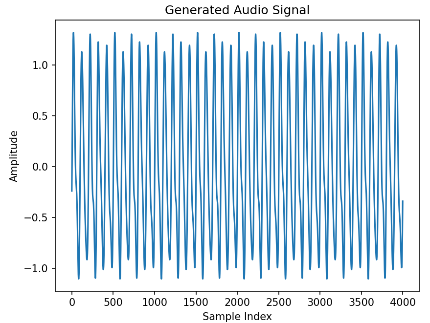
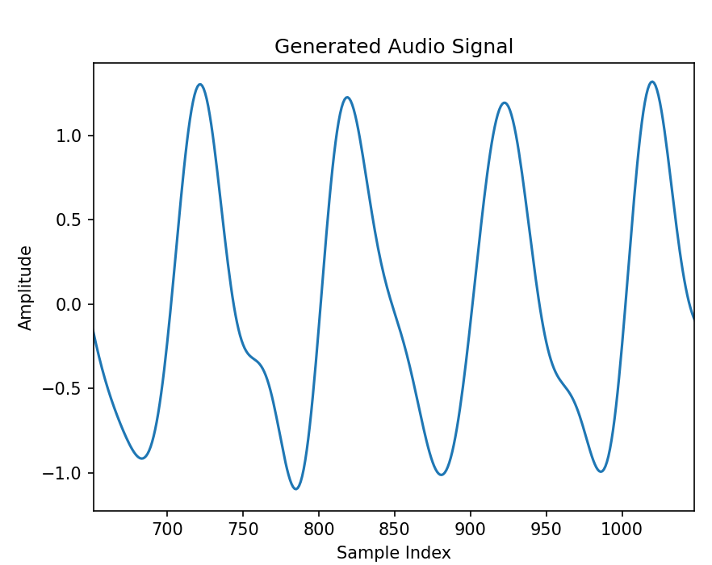

# EXP4 RNN Applications: Simple RNN

## 1 导言


## 2 任务

### 2.1 实验任务

- 利用PyTorch实现一个简单的RNN网络
- 使用RNN网络预测一个周期性音频信号
- 调整不同的参数，评估其预测性能

### 2.2 实验步骤

#### 2.2.1 构建音频信号数据

使用python编写一段代码，生成一个周期性音频信号数据，该信号采样率1ksps，时间长度4s，因此会产生4000个样本。该信号应包含10Hz、20Hz、24Hz等不同的频率分量，各分量的幅值可自行确定，但各个频率分量之间幅值差最好控制在20dB（10倍）之内。下面给出一个示例生成多项式：
$$
y(n) = \sum_{i=0}^{2} A_i \sin(2\pi f_i n+\phi_i)
$$
这里，Ai是对应索引i的信号幅值，fi是频率，φi是相位。

参考代码如下：

```python
import numpy as np
import matplotlib.pyplot as plt

def generate_audio_signal(amplitudes, frequencies, phases, sample_rate, duration):
    t = np.linspace(0, duration, int(sample_rate * duration), endpoint=False)
    signal = np.zeros_like(t)
    for idx, freq in enumerate(frequencies):
        signal += amplitudes[idx] * np.sin(2 * np.pi * freq * t + phases[idx])
    return signal

amplitudes = [1.0, 0.3, 0.1]
frequencies = [10, 20, 24]
phases = [0, 100, 200]

sample_rate = 1000  # 1ksps
duration = 4  # 4 seconds
audio_signal = generate_audio_signal(amplitudes, frequencies, phases, sample_rate, duration)

```

使用matplotlib显示一下波形，各个谐波分量应能够目视分辨。

```python
import matplotlib.pyplot as plt

plt.plot(audio_signal)
plt.title('Generated Audio Signal')
plt.xlabel('Sample Index')
plt.ylabel('Amplitude')
plt.show()
```

生成的音频数据波形如下图，右侧为放大后的波形。



保存成csv，方便后续使用

```python
t = np.arange(len(audio_signal)) / sample_rate	# time index, in unit of Second
data = np.column_stack((t, audio_signal))
np.savetxt('audio_signal.csv', data, delimiter=',', header='time_sec,amplitude', comments='', fmt='%.6f')

```


#### 2.2.2 实现一个简单的RNN网络

实现代码略。


#### 2.2.3 训练

首先，编写代码，将刚才生成的音频数据csv导入，

选择均方误差损失（MSE）函数作为模型训练的损失函数，并使用随机梯度下降（SGD）作为优化器。

参照前两次实验的代码，添加相应代码，将训练好的权重数据导出保存。

我们使用刚才生成的音频信号序列进行训练和预测，这里我们从4000个样本中挑选2000个**连续**样本作为训练集，位置可以随机。


#### 2.2.4 使用训练好的网络进行预测

在剩余的样本中随机挑选连续200~300个样本作为测试集。使用训练好的模型进行预测，注意保存predict的结果。使用matplotlib显示预测曲线。


#### 2.2.5 观察不同损失函数和优化器对于RNN训练/预测的影响

MSE损失函数适合序列预测，查阅资料，尝试其他适合序列预测场景的损失函数，并与MSE比较。

还可以尝试不同的优化器，观察这些优化器对于RNN在序列预测应用场景下的不同影响。


## 3 拓展实验

RNN常用于语音识别、语音合成、声音识别等应用领域。为了解决梯度爆炸等问题，还引入LSTM、GRU等机制。有兴趣的同学可以尝试基于PyTorch搭建加入LSTM/GRU机制的RNN网络。

相关数据集可在以下网站下载：

https://openxlab.org.cn/datasets

语音转文字的实验项目可使用LibriSpeech数据集；

声音分类识别可使用UrbanSound8K数据集；


## 参考文献

[使用Python实现循环神经网络（RNN）的博客教程](https://developer.aliyun.com/article/1503919)

[CSDN:RNN实现时间序列预测(PyTorch版)](https://blog.csdn.net/m0_68036862/article/details/133556410)

[循环神经网络RNN完全解析：从基础理论到PyTorch实战](https://cloud.tencent.com/developer/article/2348483)

https://developer.aliyun.com/article/1055115


